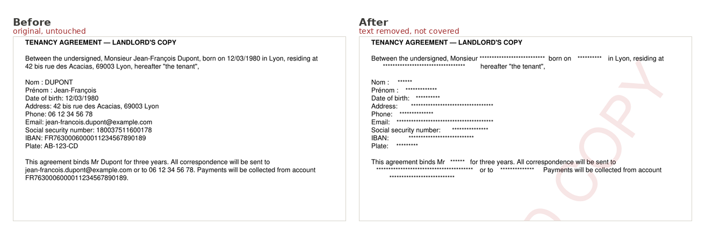
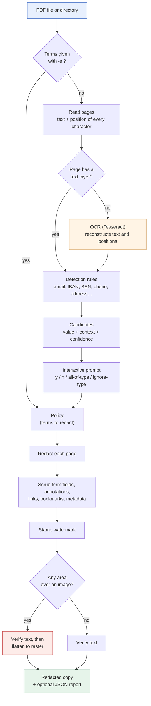
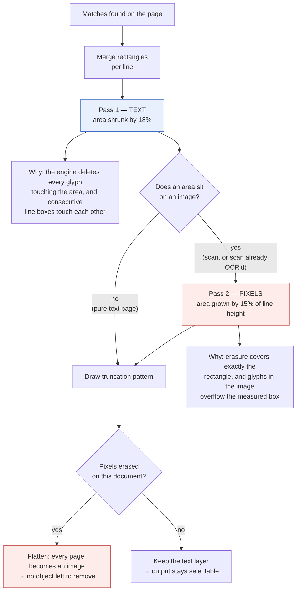
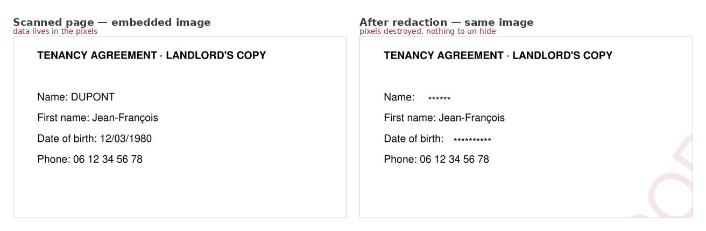
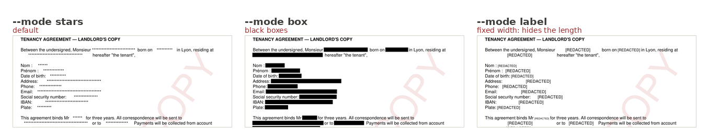

# RedactEz

Version 2.1 · Python ≥ 3.9 · one Python dependency (PyMuPDF)

A command line tool that **genuinely removes** personal data from PDFs (or a
whole directory of them) and replaces it with a visible truncation pattern
(`******`, a black box, or a `[REDACTED]` label).

> **The key point**: content is removed from the PDF content stream, not
> covered up. Drawing a black rectangle on top — what pypdf, reportlab, pdf-lib
> and most tutorials do — removes nothing: the text is still extractable by
> copy and paste. That mistake is behind several real-world leaks of court and
> government documents.

Three structural guarantees:

| Guarantee | How |
|---|---|
| The original is **never** modified | always writes to a new file, refuses an output equal to the source, uses a separate output directory by default |
| The copy is **identifiable** | watermark stamped on every page plus a dated footer line |
| The result is **checked** | the produced file is reopened and re-read; any term still extractable fails the run |



The right-hand page is not a copy with black boxes drawn on it: the names, dates
and account numbers no longer exist in the file. Select the text, copy it, run
`pdftotext` on it — there is nothing left to find.

---

## How it works



The security-critical part is what happens to a single page:



---

## Table of contents

- [Quick start](#quick-start)
- [Installation](#installation)
- [Usage](#usage)
- [Recipes](#recipes)
- [Options](#options)
- [Detected types](#detected-types)
- [File formats produced](#file-formats-produced)
- [What the tool really handles](#what-the-tool-really-handles)
- [Limits](#limits--read-before-sharing-a-document)
- [Troubleshooting](#troubleshooting)
- [Exit codes](#exit-codes)
- [Architecture](#architecture)
- [Contributing](#contributing)
- [Changelog](#changelog)

---

## Quick start

```bash
pip install -r requirements.txt

# I know what to mask
python3 -m redactez contract.pdf -s "Jane Doe" -s "jane@example.com"

# I don't: the tool detects candidates and asks
python3 -m redactez contract.pdf --policy pii.json

# A whole directory, decisions reused across files
python3 -m redactez documents/ -r --policy pii.json
```

Output: `contract.redacted.pdf` (or `documents.redacted/`), watermarked and
verified. The original is untouched.

---

## Installation

```bash
python3 -m pip install -r requirements.txt   # PyMuPDF only
```

Nothing else is required: detection, prompting, policy, progress bar and
watermark use the standard library alone.

For scanned documents, add Tesseract (a system binary):

```bash
sudo apt install tesseract-ocr tesseract-ocr-eng   # Debian / Ubuntu
brew install tesseract tesseract-lang              # macOS
winget install UB-Mannheim.TesseractOCR            # Windows (found even if not in PATH)
python3 -m redactez --check-ocr                # verify the installation
```

Handy alias:

```bash
alias redactez='python3 -m redactez'
```

---

## Usage

### 1. You know what to mask

```bash
python3 -m redactez contract.pdf \
    -s "Jean-François Dupont" \
    -s "jane@example.com" \
    -s "06 12 34 56 78"
```

Terms can also come from a file (`--strings-file terms.txt`, one per line, `#`
for comments).

Matching is tolerant: `JEAN-FRANCOIS` without accents, a `Du-\npont` broken
across lines, or repeated spaces are all found. `--case-sensitive`,
`--whole-word` and `--no-accent-folding` tighten this.

### 2. You don't — detection mode (default when no `-s` is given)

```bash
python3 -m redactez contract.pdf --policy pii.json
```

```
› Analysing 1 document · OCR auto (Tesseract (eng, fra))
⠹ Analysing ████████████░░░░░░░░░░░░  50% (1/2) contract.pdf
› 21 candidates detected

[4/21] EMAIL · high confidence · 2 occurrences
    value   : jane@example.com
    context : …Phone: 06 12 34 56 78 Email: [jane@example.com] Social security…
    where   : contract.pdf · page 1
    Redact? [Y/n/t/i/a/q/?]
```

| Key | Effect |
|---|---|
| `y` or Enter | redact this value |
| `n` | leave it alone |
| `t` | redact **every** value of this type |
| `i` | ignore **every** value of this type |
| `a` | redact all remaining candidates |
| `q` | stop asking, keep the decisions already made |

Decisions are written to `pii.json` and **replayed** on later runs: the same
question is never asked twice.

### 3. Batch processing

```bash
python3 -m redactez documents/ -r --policy pii.json
```

Without `-o`, output goes to `documents.redacted/` — a **sibling** directory, so
originals and copies never mix. The tree structure is mirrored. Writing the
output *inside* a source scanned with `-r` is refused (it would recurse and
re-redact its own output).

### 4. Scanned documents (OCR)

```bash
python3 -m redactez scan.pdf --ocr force --ocr-language eng
```

| Mode | Effect |
|---|---|
| `auto` (default) | OCR only pages with no text layer; other pages processed normally |
| `force` | OCR every page (useful when an existing text layer is poor) |
| `never` | no OCR; scanned pages are reported but not redacted |

OCR results are cached between the analysis and redaction phases: without that
cache every page would be recognised twice (~1 s per page).

### 5. Irreversible redaction

A redaction placed over an **image** (a scan, or a scan already OCR'd by
another tool) raises a problem plain text does not have: if only text objects
are removed, the data stays in the pixels underneath a white rectangle that
anyone can delete in a PDF editor. The tool handles this in two steps.

**1. Pixel erasure.** As soon as a redaction area overlaps an image, the
corresponding pixels are destroyed in the embedded image — not hidden.
Redaction then runs in two passes: a text pass flush with the line (so
neighbouring lines are not cut off), and a pixel pass with a margin
proportional to the line height (so the tops of letters do not survive).



Both panels above show the *raw image extracted from the PDF*, not the rendered
page. On the right the pixels are simply gone: there is no layer to delete, no
object to remove, nothing for an editor or a model to recover.

**2. Flattening.** The produced document is rasterized: each page becomes an
image, so there is no object left to remove — not for a human in Acrobat, not
for an automated tool.

```bash
python3 -m redactez scan.pdf --flatten            # force, even on plain text
python3 -m redactez contract.pdf --flatten never  # keep the text layer
python3 -m redactez scan.pdf --verify-image       # OCR-based proof
```

| `--flatten` | Effect |
|---|---|
| `auto` (default) | flattens **whenever a redacted area sits on an image** — so any scan, OCR'd or not. A pure text PDF stays intact and selectable |
| `always` | flattens every document |
| `never` | no rasterization (pixel erasure still applies) |

Tuning: `--flatten-dpi` (default 200) and `--flatten-quality` (JPEG, default 85;
`100` = lossless).

**Trade-off**: a flattened document is no longer selectable, searchable or
accessible to screen readers. On a scan that costs nothing, since there was no
text to begin with.

**`--verify-image` is the only meaningful proof on a scan.** The default check
re-reads the text layer of the produced file — it sees nothing of what remains
in the pixels. `--verify-image` runs OCR on the output and fails if any term is
still readable. It is slow (~1 s per page) but it is the only check that proves
anything about a rasterized document.

### 6. Dry run

```bash
python3 -m redactez contract.pdf --dry-run
```

Full analysis and prompting, no file written.

---

## Recipes

**Send a batch of contracts to a third party**

```bash
python3 -m redactez contracts/ -r --policy pii.json --mode label -v
```
`--mode label` writes `[REDACTED]`, a fixed-width marker: the size of the gap
does not hint at the length of the name.

**Automated pipeline (CI, cron), no prompting**

```bash
python3 -m redactez incoming/ -r -o outgoing/ \
    --auto EMAIL,IBAN,FR_SSN,CREDIT_CARD,PHONE \
    --report report.json -q
echo $?   # 0 = all verified, 1 = at least one failure
```

**Replay exactly the same decisions on a new batch**

```bash
python3 -m redactez new_batch/ -r --policy pii.json --no-detect
```

**Answer a GDPR access request (mask third parties)**

```bash
python3 -m redactez client_file/ -r \
    --types NAME_WITH_TITLE,EMAIL,PHONE,ADDRESS \
    --min-confidence medium --policy third_parties.json
```

**Batch of poor-quality scans**

```bash
python3 -m redactez scans/ -r --ocr force --ocr-dpi 300 --verify-image -v
```

---

## Options

### Input / output
| Option | Purpose |
|---|---|
| `-o`, `--output` | output file (single input) or output directory |
| `-r`, `--recursive` | walk sub-directories |
| `--suffix` | suffix of produced files/directories (default `.redacted`) |
| `--force` | overwrite an existing output |
| `--report` | write a detailed JSON report |

### What to redact
| Option | Purpose |
|---|---|
| `-s`, `--string` | string to redact (repeatable) |
| `--strings-file` | file of terms, one per line |
| `--policy` | JSON decision file, read **and** updated |
| `--detect` / `--no-detect` | force / disable automatic detection |
| `--types` | detected types (see `--list-types`) |
| `--list-types` | list detectable types and exit |
| `--auto TYPES` | types redacted without prompting |
| `--accept-all` | accept every candidate |
| `--min-confidence` | `low` / `medium` / `high` |

### Rendering
| Option | Purpose |
|---|---|
| `--mode` | `stars` (default), `box`, `label` |
| `--char` | truncation character (default `*`) |
| `--label` | text used in `label` mode |
| `--watermark TEXT` | watermark text (default `REDACTED COPY`) |
| `--no-watermark` | disable the watermark |
| `--no-footer` | watermark without the dated footer line |
| `--watermark-opacity` | 0 to 1 (default 0.11) |



`stars` and `box` preserve the geometry, so the width of the gap hints at the
length of the hidden word. `label` writes a fixed-width marker instead, which gives
nothing away — at the cost of a slightly noisier page.

### Matching
| Option | Purpose |
|---|---|
| `--whole-word` | whole-word matches only |
| `--case-sensitive` | respect letter case |
| `--no-accent-folding` | do not treat `e` and `é` as equivalent |

### OCR
| Option | Purpose |
|---|---|
| `--ocr` | `auto` (default), `force`, `never` |
| `--ocr-language` | `eng`, `fra`, `fra+eng`… (`auto` by default) |
| `--ocr-dpi` | rendering resolution, 72–600 (default 200) |
| `--check-ocr` | print installation diagnostics and exit |

### Irreversibility
| Option | Purpose |
|---|---|
| `--flatten [MODE]` | `auto` (default), `always`, `never` — bare flag means `always` |
| `--flatten-dpi` | rasterization resolution, 72–600 (default 200) |
| `--flatten-quality` | JPEG quality 30–100; 100 = lossless (default 85) |
| `--verify-image` | re-read the output with OCR, fail if a term is still readable |

### Misc
| Option | Purpose |
|---|---|
| `--keep-metadata` | do not strip metadata |
| `--redact-images` | erase pixels under **every** redacted area |
| `--no-verify` | skip re-reading the produced file |
| `--dry-run` | write nothing |
| `--color` | `auto`, `always`, `never` (honours `NO_COLOR`) |
| `-v`, `--verbose` | per-term and per-file detail |
| `-q`, `--quiet` | errors only |
| `--version`, `-h` | version, help |

---

## Detected types

`python3 -m redactez --list-types`

| Type | Confidence | Check |
|---|---|---|
| `EMAIL` | high | — |
| `FR_SSN` | high | French social security checksum (mod 97) |
| `IBAN` | high | IBAN checksum (mod 97) |
| `CREDIT_CARD` | high | Luhn |
| `LABELED_FIELD` | high | value after `Name:`, `Date of birth:`, `Address:`… |
| `PHONE` | medium | 9–10 digits, international prefixes accepted |
| `DATE` | medium | numeric and spelled out (`12 March 1980`) |
| `ADDRESS` | medium | number + street type + city |
| `NAME_WITH_TITLE` | medium | name preceded by `Mr`, `Mrs`, `Dr`, `M.`, `Mme`… |
| `LICENSE_PLATE` | medium | `AB-123-CD` |
| `IP` | medium | IPv4 |
| `POSTAL_CODE_CITY` | low | postal code + city |
| `UPPERCASE_NAME` | low | off by default (noisy) |

Checksum validators remove most false positives: a 15-digit run that is not a
valid French SSN is never proposed.

Rules recognise both English and French keywords (street types, field labels,
titles, month names). The codebase is English; the rule set is
locale-dependent by nature and contributions for other locales are welcome.

---

## File formats produced

### Policy (`--policy pii.json`)

```json
{
  "version": 1,
  "redact": ["06 12 34 56 78", "DUPONT", "jane@example.com"],
  "ignore": ["Lyon"],
  "kind_rules": { "EMAIL": "always", "DATE": "never" }
}
```

Hand-editable: add terms to `redact`, permanently discard a value in `ignore`,
or settle a whole type with `kind_rules` (`always` / `never`). Comparison
ignores case, accents and repeated whitespace.

> **This file holds personal data in clear text.** It is created with mode
> `0600`; protect or delete it like the source document. Add it to
> `.gitignore`.

### Report (`--report report.json`)

```json
{
  "version": "2.1.0",
  "date": "2026-09-08T15:12:42",
  "options": { "mode": "stars", "ocr": "auto", "flatten": "auto",
               "watermark": "REDACTED COPY", "verify": true, "verify_image": false },
  "terms": ["06 12 34 56 78", "12/03/1980"],
  "files": [
    {
      "source": "documents/contract.pdf",
      "output": "documents.redacted/contract.pdf",
      "pages": 2,
      "ocr_pages": [],
      "image_redacted_pages": [],
      "flattened": false,
      "total_occurrences": 37,
      "duration_s": 0.063,
      "terms": [{ "term": "06 12 34 56 78", "occurrences": 2 }],
      "warnings": [],
      "errors": [],
      "verified": true,
      "residual": [],
      "verified_image": null,
      "residual_image": []
    }
  ]
}
```

`verified: false` with a non-empty `residual` means a term is still
extractable: **the document must not be distributed as is**.

`verified_image` stays `null` until `--verify-image` is used. On a document
with `flattened: true`, `verified: true` proves nothing on its own —
`verified_image` is the one that counts.

---

## What the tool really handles

- **Body text**, including matches broken across lines (`Du-\npont`) and case
  or accent variants (`JEAN-FRANCOIS`).
- **Scanned pages**, through OCR plus destruction of the pixels in the embedded
  image.
- **Already-OCR'd scans** (image plus invisible text layer): the case where
  removing text alone would leave the data readable under a white rectangle.
- **Form fields** (AcroForm widgets) — their values do not appear in the page
  text and are missed by most tools.
- **Annotations**: content, author, subject.
- **Hyperlinks** containing personal data (`mailto:` in clear text).
- **Bookmarks** (table of contents).
- **Metadata**, both classic and XMP, stripped by default.
- **Final check**: the produced file is reopened; if a term is still
  extractable the run fails and lists the terms.

---

## Limits — read before sharing a document

1. **Automatic detection is not exhaustive.** It does not replace a read
   through: a name without a title, implicit data ("the branch manager in
   Melun"), a handwritten signature will all slip past.
2. **OCR is imperfect recognition.** A misread word is not redacted. On a
   sensitive scan, read the output page by page and raise `--ocr-dpi` (300)
   when quality is poor.
3. **The default check reads the text layer, not the pixels.** On a scan,
   `verified: true` proves nothing: use `--verify-image`, or inspect visually.
4. **Text inside an image that was not OCR'd** (logo, stamp, screenshot) is not
   detected.
5. **Encrypted PDFs** must be decrypted first
   (`qpdf --password=… --decrypt source.pdf clear.pdf`).
6. **Embedded files** are reported but not analysed.
7. **Pixel erasure slightly clips neighbouring lines** when an area sits on an
   image. This is deliberate — the error leans towards protection.
8. Redaction **preserves geometry**: the width of the gap hints at the length
   of the word. Use `--mode label` when that matters.
9. **Coloured background**: `stars` and `label` modes paint the area white. On
   a non-white background use `--mode box`.

---

## Troubleshooting

| Symptom | Likely cause and fix |
|---|---|
| `0 occurrences` although the term is visible | scanned document → `--check-ocr`, then `--ocr force`; or different spelling/punctuation in the PDF |
| `terms still extractable after redaction` | the term appears somewhere not covered (embedded file, locked field). The file must not be distributed: see the report warnings |
| Data still readable in the output PDF | re-run with `--flatten` and `--verify-image`; flag the document as not distributable |
| Output no longer selectable | automatic flattening (an area sat on an image): use `--flatten never` to keep the text |
| Output file very large | `--flatten-dpi 150` or `--flatten-quality 70` |
| `password protected PDF` | `qpdf --password=PW --decrypt source.pdf clear.pdf` |
| `unreadable or damaged PDF` | `qpdf --replace-input --qdf file.pdf` then retry |
| `values still to confirm, but standard input is not a terminal` | non-interactive run: add `--accept-all`, `--auto TYPES` or `--policy` |
| Too many false positives | raise `--min-confidence medium`, narrow `--types`, or answer `i` when prompted |
| A neighbouring word is masked too | `--whole-word` |
| No progress bar | expected outside a terminal (pipe, CI, `-q`) |
| Unreadable output in logs | `--color never` or the `NO_COLOR` variable |

---

## Exit codes

```
Result
──────
  ✓  contract.pdf  37  2 p.  0.1s  → contract.redacted.pdf
  ✖  scan.pdf       0  4 p.  0.2s

⚠ scan.pdf: page 2: no text layer (scanned page). OCR unavailable — …
✖ 2 files · 37 occurrences redacted · 1 failure(s)
```

| Code | Meaning |
|---|---|
| `0` | every file processed and verified |
| `1` | at least one failure (residual term, existing output, unreadable document…) |
| `2` | usage error (path, type, policy, invalid option) |
| `130` | keyboard interrupt — files already written are kept |

---

## Architecture

```
redactez/
  textmap.py        PageText: page text + per-character boxes; geometry helpers
  matching.py       tolerant patterns (case, accents, hyphenation, spacing)
  detectors.py      detection rules + checksum validators
  policy.py         decisions persisted as JSON, O(1) folded-form index
  ocr.py            Tesseract discovery and invocation
  watermark.py      watermark stamped on produced documents
  progress.py       progress bar (stdlib, silent outside a TTY)
  ui.py             colours, messages, tables
  backends/base.py  Backend ABC, options, typed errors, registry
  backends/pdf.py   PDF implementation (PyMuPDF) — most of the work lives here
  cli.py            arguments, phases, prompting, summary
```

### Adding a format

```python
from redactez.backends.base import Backend, FileReport, register

@register
class DocxBackend(Backend):
    name = "docx"
    extensions = (".docx",)

    def read_pages(self, path, options=None, progress=None): ...    # -> List[PageText]
    def redact(self, path, out, terms, options, progress=None): ... # -> FileReport
```

`PageText` may be supplied without geometry (`boxes=[]`) when substitution
happens on the text itself. Detection, prompting, policy, watermark, reporting,
progress and the CLI then work unchanged.

### Using it as a library

```python
from pathlib import Path
from redactez import RedactionOptions, get_backend

backend = get_backend(Path("contract.pdf"))
report = backend.redact(
    Path("contract.pdf"),
    Path("contract.redacted.pdf"),
    ["Jane Doe", "jane@example.com"],
    RedactionOptions(mode="label", watermark="INTERNAL COPY"),
)
print(report.total_occurrences, report.verified, report.warnings)
```

### Performance notes

- Extraction and OCR are cached (LRU bounded at ~4 M characters) between the
  analysis and redaction phases, and backend instances are shared: on a batch
  of scans, OCR runs once instead of twice — roughly a 10× saving.
- `merge_line_rects()` merges by sorted line bands, O(n log n) instead of
  pairwise comparison.
- Policy decisions are indexed by folded form: O(1) lookup.
- Rough figures: 50 pages of native text ≈ 1 s; OCR ≈ 1 s per page; flattening
  ≈ 0.2 s per page at 200 dpi.

---

## Contributing

```bash
python3 -m unittest discover -s tests -q     # 73 tests, ~5 s
```

OCR tests skip themselves when Tesseract is missing, so the suite passes on a
bare machine.

Please read [CLAUDE.md](CLAUDE.md) before changing the redaction logic: it
documents the invariants and the non-obvious traps (two-pass redaction,
verification before flattening, PyMuPDF API quirks) that are easy to break
silently.

Generate a test PDF containing **fictional** data:

```bash
python3 -m pip install reportlab
python3 tests/make_sample.py /tmp/sample.pdf
```

Regenerate the README screenshots (all from fictional data, nothing committed by
hand):

```bash
python3 -m pip install reportlab pillow
python3 docs/make_screenshots.py
```

---

## Changelog

### Rename
- The project is now **RedactEz**: package `redactez`, command `redactez`
  (`python3 -m redactez`). Replaces `pdf_redactor` / `pdf-redactor`.

### 2.1 — fixes
- **Data leak fixed**: answering `t` ("redact every value of this type") only
  redacted the current value; the other values of that type were skipped.
  Type rules saved in a `--policy` file were ignored the same way.
- `--whole-word` no longer makes the final check fail on every document
  ("Martin" was reported as still present inside "Martinez").
- The final check now uses the same tolerant matching as redaction (catches
  hyphenated line breaks) and also reads bookmarks, links and annotation
  authors/subjects.
- Two matches on the same line in different fonts could be merged into one
  area, erasing all the text between them.
- Accent folding covers every Latin letter (`Dvořák`, `Łódź`), not only French.
- `LABELED_FIELD` no longer fires inside words (`Hôtel :`, `username:`).
- `redactez .` crashed; two inputs producing the same output file now fail
  instead of overwriting each other; a single-character term in a policy file
  is refused; earlier `*.redacted.pdf` outputs in a scanned directory are
  skipped.
- Output is written to a temporary file then renamed: no truncated PDF after a
  crash. An unexpected error on one file no longer aborts the batch.
- Tesseract is found in its default Windows install location.

### 2.0 — breaking
- The whole project is now in English: code, comments, messages, CLI options,
  documentation, and the JSON report keys.
- Detection type names renamed (`NIR` → `FR_SSN`, `TELEPHONE` → `PHONE`,
  `CHAMP_NOMME` → `LABELED_FIELD`, …); confidence levels are now
  `low` / `medium` / `high`.
- Default suffix `.caviarde` → `.redacted`; default watermark
  `DOCUMENT CAVIARDÉ` → `REDACTED COPY`; default label `[CAVIARDÉ]` →
  `[REDACTED]`.

| 1.x flag | 2.0 flag |
|---|---|
| `--sortie` | `--output` |
| `--chaine` | `--string` |
| `--fichier-chaines` | `--strings-file` |
| `--politique` | `--policy` |
| `--detecter` / `--sans-detection` | `--detect` / `--no-detect` |
| `--tout-accepter` | `--accept-all` |
| `--confiance-min` | `--min-confidence` |
| `--caractere` / `--mention` | `--char` / `--label` |
| `--filigrane` / `--sans-filigrane` | `--watermark` / `--no-watermark` |
| `--mot-entier` / `--sensible-casse` | `--whole-word` / `--case-sensitive` |
| `--langue-ocr` / `--dpi-ocr` | `--ocr-language` / `--ocr-dpi` |
| `--aplatir` / `--verifier-image` | `--flatten` / `--verify-image` |
| `--simulation` / `--forcer` | `--dry-run` / `--force` |
| `--recursif` / `--suffixe` | `--recursive` / `--suffix` |
| `--verbeux` / `--silencieux` | `--verbose` / `--quiet` |

Policy files written by 1.x remain compatible (their keys were already English).

### 1.2
- **Security fix**: on an already-OCR'd scan (image plus text layer) only the
  text was removed, leaving the data readable in the image under a white
  rectangle. Pixels are now destroyed whenever a redacted area overlaps an
  image.
- Two-pass redaction (text flush with the line, pixels with a proportional
  margin) so neighbouring lines survive.
- Flattening of the produced document (`--flatten`), automatic whenever an area
  sits on an image.
- `--verify-image`: OCR-based check of the output.

### 1.1
- OCR of scanned pages through Tesseract, watermark by default, sibling output
  directory, progress bar and coloured summary, typed errors with actionable
  hints, LRU extraction cache.

### 1.0
- True text removal, 13 detection types, interactive prompting, replayable JSON
  policy, batch processing, final verification.

---

## GDPR note

Redaction reduces risk but does not guarantee anonymisation under the GDPR: a
document can remain re-identifiable by cross-referencing even without a name.
Treat the result as **pseudonymisation** and have the document reviewed before
sharing it.
